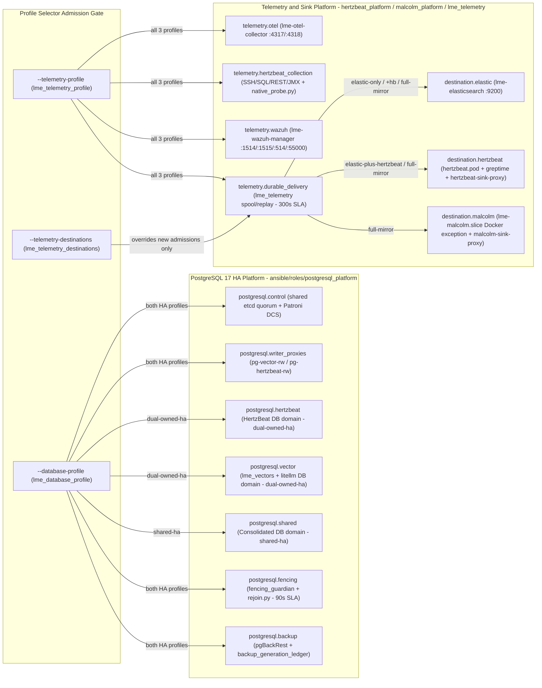

# LME E2E Service Topology DAG, Profile Composition Model, and 10-Axis Validation Matrix

> **Status (`2026-10-22`):** Source and component milestone at `develop` (`v2.4.0-rc.1`, parent `c1af5f6`). `qualified_runtime_cells` remains `0` (source/component milestone, not a validated live host deployment).

## 1. Full Declarative Service Topology DAG (29 Manifest Units + Platform Roles)

### 1.1 Systemd / Quadlet Dependency and Activation DAG (`manifests/services/*.yml` + `ansible/site.yml`)

```mermaid
flowchart TD
  subgraph targetLayer [1. Umbrella Target and Podman Network]
    lmeTarget["lme.service (target - enabled: always)"]
    lmeNet["lme-network.service (network: lme - enabled: always)"]
    lmeTarget --> lmeNet
  end

  subgraph volumeLayer [2. Declarative Podman Volumes]
    volEs["lme-esdata01-volume.service (volume: lme_esdata01 - always)"]
    volKibana["lme-kibanadata-volume.service (volume: lme_kibanadata - always)"]
    volBackups["lme-backups-volume.service (volume: lme_backups - always - migration-evidence-store)"]
    volFilebeat["lme-filebeatdata-volume.service (volume: lme_filebeatdata - install_elastic_services)"]
    volPgvec["lme-pgvectordata-volume.service (volume: lme_pgvectordata - install_llm - authoritative-initialized-storage)"]
    lmeTarget --> volEs
    lmeTarget --> volKibana
    lmeTarget --> volBackups
    lmeTarget --> volFilebeat
    lmeTarget --> volPgvec
  end

  subgraph bootstrapLayer [3. Cert and Account Oneshot Bootstrap]
    setupCerts["lme-setup-certs.service (oneshot - always - userns: auto_unpinned)"]
    certsRole["Ansible role: certs (publishes /opt/lme/certs/svc + GAP-2 distribute_ca)"]
    secretsRole["Ansible role: secrets_distribution (GAP-4 consumer secrets + guardian custody)"]
    setupAccts["lme-setup-accts.service (oneshot - always - userns: container:lme-elasticsearch)"]
    lmeNet --> setupCerts
    volEs --> setupCerts
    volKibana --> setupCerts
    setupCerts --> certsRole
    certsRole --> secretsRole
  end

  subgraph coreStack [4. Core Always-On Stack - Pinned Rootless UserNS Slots]
    es["lme-elasticsearch.service (slot 0: 165536 - 127.0.0.1:9200, cluster 0.0.0.0:9300 - VIP: lme-elasticsearch)"]
    kibana["lme-kibana.service (slot 1: 168584 - 127.0.0.1:5601, 443 to 5601 - VIP: lme-kibana)"]
    fleetSrv["lme-fleet-server.service (slot 2: 171632 - 127.0.0.1:8220 - cond: FLEET_SETUP_FINISHED)"]
    fleetDist["lme-fleet-distribution.service (host_userns - 127.0.0.1:8080 - cond: OFFLINE_MODE)"]
    wazuh["lme-wazuh-manager.service (slot 3: 174680 - 1514/tcp, 1515/tcp, 514/udp, 55000/tcp)"]
    elastalert["lme-elastalert.service (slot 4: 177728 - internal alerting)"]
    certsRole --> es
    lmeNet --> es
    es --> setupAccts
    setupAccts --> kibana
    volKibana --> kibana
    es --> kibana
    es --> fleetSrv
    kibana --> fleetSrv
    es --> fleetDist
    setupCerts --> fleetDist
    es --> wazuh
    es --> elastalert
  end

  subgraph aiPack [5. AI / LLM and WebUI Pack - enabled_when: install_llm]
    pgvector["lme-pgvector.service (127.0.0.1:5432 - mutually exclusive with HA DB profiles)"]
    embeddings["lme-embeddings.service (127.0.0.1:8081 - nomic-embed-text-v1.5)"]
    llamacpp["lme-llama-cpp.service (local GGUF inference)"]
    litellm["lme-litellm.service (127.0.0.1:4000 - VIP: lme-litellm - ingress: https)"]
    dashboard["lme-dashboard.service (127.0.0.1:8502 - VIP: lme-dashboard)"]
    logAnalyzer["lme-log-analyzer.service (127.0.0.1:8501 - VIP: lme-log-analyzer)"]
    llamaModelPath["lme-llama-model.path + .service (path_service)"]
    llmKeysPath["lme-llm-keys.path + .service (path_service)"]
    volPgvec --> pgvector
    lmeNet --> pgvector
    lmeNet --> embeddings
    lmeNet --> llamacpp
    llamacpp --> litellm
    pgvector --> litellm
    llmKeysPath --> litellm
    es --> dashboard
    litellm --> dashboard
    pgvector --> dashboard
    embeddings --> dashboard
    es --> logAnalyzer
    litellm --> logAnalyzer
  end

  subgraph telemetryPack [6. Elastic Services and OTel Pack - enabled_when: install_elastic_services / install_otel]
    apm["lme-apm-server.service (install_elastic_services - 127.0.0.1:8200 - ingress: https)"]
    logstash["lme-logstash.service (install_elastic_services - 127.0.0.1:5044 raw-tcp, 8085 http)"]
    heartbeat["lme-heartbeat.service (install_elastic_services)"]
    filebeat["lme-filebeat.service (install_elastic_services + install_legacy_beats)"]
    metricbeat["lme-metricbeat.service (install_elastic_services + install_legacy_beats)"]
    otel["lme-otel-collector.service (install_otel - 127.0.0.1:4317 gRPC, 4318 HTTP)"]
    es --> apm
    setupCerts --> apm
    es --> logstash
    setupCerts --> logstash
    es --> heartbeat
    kibana --> heartbeat
    es --> filebeat
    volFilebeat --> filebeat
    kibana --> filebeat
    es --> metricbeat
    kibana --> metricbeat
    setupCerts --> otel
    es --> otel
  end
```

### 1.2 Extended Platform Roles and Semantic Role Bindings (`manifests/contracts/profile-selectors.yml`)

### 1.3 Rootless UserNS Slot and Port Allocation Contract ([`manifests/global.yml`](/home/tristan/gitters/LME/.worktrees/reconcile-dev-a-696d87a6/manifests/global.yml))
- **Base subuid formula**: `subuid_base: 165536`, `subuid_range: 65536`, `slot_size: 3048` (`auto:uidmapping=0:{base}:{size},gidmapping=0:{base}:{size}`).
  - **Slot `0` (`elasticsearch`)**: base `165536` (`in_container_uid: 1000` -> host UID `166536`; `lme-setup-accts` shares `container:lme-elasticsearch`).
  - **Slot `1` (`kibana`)**: base `168584` (`in_container_uid: 1000` -> host UID `169584`).
  - **Slot `2` (`fleet-server`)**: base `171632` (`in_container_uid: 0` -> host UID `171632`).
  - **Slot `3` (`wazuh-manager`)**: base `174680` (`in_container_uid: 0` -> host UID `174680`).
  - **Slot `4` (`elastalert`)**: base `177728`.
  - **Unslotted / `auto_unpinned`**: `lme-setup-certs` (`UserNS=auto`), `lme-backups` (`165536` owner base).
- **29 Declared Units (`manifests/services/*.yml`)**:
  - **Target & Network (2)**: `lme.service` (`kind: target`, `enabled_when: [always]`), `lme-network.service` (`kind: network`, `enabled_when: [always]`).
  - **Volumes (5)**: `lme-esdata01-volume.service` (`always`), `lme-kibanadata-volume.service` (`always`), `lme-backups-volume.service` (`always`, `migration-evidence-store`), `lme-filebeatdata-volume.service` (`install_elastic_services`), `lme-pgvectordata-volume.service` (`install_llm`, `authoritative-initialized-storage`).
  - **Oneshot Bootstrap (2)**: `lme-setup-certs.service` (`always`, `Requires=network,esdata01,kibanadata`), `lme-setup-accts.service` (`always`, `Requires=network,setup-certs,elasticsearch`).
  - **Core Always-On Containers (6)**:
    - `lme-elasticsearch.service` (`127.0.0.1:9200`, cluster `0.0.0.0:9300`, VIP `lme-elasticsearch`, secrets: `elastic`, `kibana_system`).
    - `lme-kibana.service` (`127.0.0.1:5601`, `127.0.0.1:443->5601`, VIP `lme-kibana`, secret: `kibana_system`).
    - `lme-fleet-server.service` (`127.0.0.1:8220`, `0.0.0.0:8220` in `multinode`, `ConditionPathExists=/opt/lme/FLEET_SETUP_FINISHED`, secret: `elastic`).
    - `lme-fleet-distribution.service` (`127.0.0.1:8080`, `ConditionPathExists=/opt/lme/OFFLINE_MODE`).
    - `lme-wazuh-manager.service` (`127.0.0.1:1514/tcp`, `1515/tcp`, `514/udp`, `55000/tcp`, secrets: `wazuh`, `wazuh_api`, `elastic`).
    - `lme-elastalert.service` (internal alerting, secret: `elastic`).
  - **AI / LLM & WebUI Pack (`enabled_when: [install_llm]`, 8 units)**:
    - `lme-pgvector.service` (`127.0.0.1:5432`, secret: `pgvector`, mutually exclusive with HA DB profiles).
    - `lme-embeddings.service` (`127.0.0.1:8081`, `nomic-embed-text-v1.5`).
    - `lme-llama-cpp.service` (internal GGUF inference).
    - `lme-litellm.service` (`127.0.0.1:4000`, `tailnet_ingress: https`, VIP `lme-litellm`, secrets: `llm-keys`, `pgvector`, `litellm_master_key`).
    - `lme-dashboard.service` (`127.0.0.1:8502`, VIP `lme-dashboard`, `Requires=elasticsearch,litellm,pgvector,embeddings`, secrets: `elastic`, `pgvector`, `litellm_master_key`, `webui_api_key`).
    - `lme-log-analyzer.service` (`127.0.0.1:8501`, VIP `lme-log-analyzer`, `After=elasticsearch,litellm`, secrets: `elastic`, `litellm_master_key`, `webui_api_key`).
    - `lme-llama-model.{path,service}` and `lme-llm-keys.{path,service}` (`kind: path_service` watchers).
  - **Elastic Services & OTel Pack (6 units)**:
    - `lme-apm-server.service` (`install_elastic_services`, `127.0.0.1:8200`, `tailnet_ingress: https`).
    - `lme-logstash.service` (`install_elastic_services`, `127.0.0.1:5044` `raw-tcp`, `127.0.0.1:8085` `tcp`).
    - `lme-heartbeat.service` (`install_elastic_services`).
    - `lme-filebeat.service` (`install_elastic_services` + `install_legacy_beats`).
    - `lme-metricbeat.service` (`install_elastic_services` + `install_legacy_beats`).
    - `lme-otel-collector.service` (`install_otel`, `127.0.0.1:4317` OTLP gRPC, `127.0.0.1:4318` OTLP HTTP, secret: `otel_elastic_api_key`).

---

## 2. Complete Profile and Selector Composition Model

### 2.1 Five-Tier Configuration Precedence and Merge Order
- **Precedence (`lme_config_registry.precedence`)**:
  1. `extra_var` (`-e` CLI flags from `install.sh` or operator)
  2. `inventory` (`host_vars` / `group_vars`)
  3. `profile` (`manifests/profiles/<name>.yml` + composed selector overlays)
  4. `observation` (detected host/upgrade state, permitted ONLY when `upgrade_fallback: true`: `install_elastic_services`, `offline_mode`, and `lme_observed_cluster_uuid` [`observation_only: true`])
  5. `default` (`manifests/global.yml` field defaults)
- **Overlay Composition Order ([`manifests/contracts/profile-selectors.yml`](/home/tristan/gitters/LME/.worktrees/reconcile-dev-a-696d87a6/manifests/contracts/profile-selectors.yml))**:
  - `base_profile` -> `database_profile` -> `telemetry_profile` -> `operator` (`lme_service_overrides` LAST).

### 2.2 Profile Axes
- **Axis A: Base Deployment Profiles (`--profile` / `lme_profile`)**:
  - `default`: Single-node (`es_discovery: single-node`), all 18 ports bound to `127.0.0.1`, `install_llm: true`, `install_legacy_beats: true`.
  - `cluster`: Multi-node ES cluster (`es_discovery: cluster`), opens `0.0.0.0:9300`, sets ES heap `8g` (`memory_high: 12G`, `memory_max: 16G`).
  - `multinode`: Single-node ES with remote Fleet agents; opens `fleet-server:8220` (`fleet_enrollment_bind_address | default('0.0.0.0')`) and `elasticsearch:9200` (or shifts ES host port to `127.0.0.1:19200` when `tailscale_serve_services: true` so Tailscale VIP fronts `9200`).
  - `offline`: Disconnected install (`offline_mode: true`, `install_elastic_services: false`), enables `lme-fleet-distribution:8080` via `/opt/lme/OFFLINE_MODE`.
  - `tailscale`: Enables `tailscale_serve_ingress: true`, `tailscale_serve_egress: true`, `tailscale_serve_services: true`, `tailscale_require_vip_live: true`; keeps `kibana`, `dashboard`, `log-analyzer` loopback-bound behind Tailscale Serve/VIPs (`lme-elasticsearch`, `lme-kibana`, `lme-litellm`, `lme-dashboard`, `lme-log-analyzer`).
  - `consumer`: Cross-host UI/AI consumer (`install_llm: true`, `lme_consumer_profile: true`, `es_discovery: single-node`); pairs with GAP-1..5 (`lme_distribute_ca`, `lme_distribute_secrets`, `lme_host_rendered_services`) to run UI/AI against a remote producer's ES VIP.
  - `remote-harness`: Controller/target execution harness profile (`manifests/profiles/remote-harness.yml`) driving toolchain generation, N13 durable staging/lease/transaction/reaper, and E2E controls.
  - Assigned extensions: `isolated` (single-deployment/no-cluster composition over `default`) and `airgapped` (complete media/OCI/APT dependency closure over `offline`).
- **Axis B: Database Profiles (`--database-profile` / `lme_database_profile`)**:
  - Omitted (`""`): Uses local `lme-pgvector` container when `install_llm: true`.
  - `dual-owned-ha`: Dedicated PostgreSQL 17/Patroni domains `postgresql.hertzbeat` + `postgresql.vector` + `postgresql.control` + `postgresql.writer_proxies` + `postgresql.backup` + `postgresql.fencing`.
  - `shared-ha`: Consolidated PostgreSQL 17/Patroni domain `postgresql.shared` + `postgresql.control` + `postgresql.writer_proxies` + `postgresql.backup` + `postgresql.fencing`.
  - Invariant: No automatic fallback from `dual-owned-ha` to `shared-ha`; changing database profiles on initialized storage requires explicit migration (`config/postgresql-platform/migration-workflow.contract.yaml`).
- **Axis C: Telemetry Profiles (`--telemetry-profile` / `lme_telemetry_profile` and `--telemetry-destinations`)**:
  - Omitted (`""`): Preserves existing behavior (`install_otel: false`, `install_legacy_beats: true`).
  - `elastic-only`: Sets `install_otel: true, install_legacy_beats: false`; destinations `[elastic]`.
  - `elastic-plus-hertzbeat`: Sets `install_otel: true, install_legacy_beats: false`; destinations `[elastic, hertzbeat]`.
  - `full-mirror`: Sets `install_otel: true, install_legacy_beats: false`; destinations `[elastic, hertzbeat, malcolm]`.
  - Destination removal invariant: Removing a destination via `--telemetry-destinations` affects **new admissions only**; outstanding spooled payloads, credentials, and checkpoints are retained until delivery finishes.
- **Axis D: Tailscale Independent Controls (6) and Certificate Modes (3)**:
  - Independent controls: `enrollment`, `node_serve`, `service_vip`, `egress`, `file_certificates`, `telemetry`.
  - Certificate modes: `serve_managed_https`, `tailscale_file_certificates`, `self_signed_and_internal_ca`.

---

## 3. Full E2E Validation Matrix (10 Axes x 84 Requirements x 251 Rows x 161 Scenarios)

### 3.1 The 10 Orthogonal Matrix Axes ([`.communication/roadmap.yaml`](/home/tristan/gitters/LME/.communication/roadmap.yaml) and [`.communication/state.yaml`](/home/tristan/gitters/LME/.communication/state.yaml))
- **Axis 1 (`vcs_stage_and_commit`)**: `develop` (`refs/heads/develop`), `testing` (`refs/heads/testing`), `main` (`refs/heads/main`), plus exact resolved `HEAD` commit and tree SHA bound in every receipt.
- **Axis 2 (`cluster_or_isolated_identity`)**: `isolated` (no-cluster single deployment) vs declared `cluster` identity (`lme_deployment_identity`, `lme_observed_cluster_uuid`).
- **Axis 3 (`cluster_branch_and_lineage`)**: Deployment identity, cluster branch, parent lineage, and configuration revision (`lme_resolved_revision`) tracked independently of Git refs.
- **Axis 4 (`principal_and_acl_scope`)**: Rootless owner subuids, capability sets, tenant-cluster/kernel/URI ACL scope, `identity_proxy` browser auth, and negative denial probes.
- **Axis 5 (`topology`)**:
  - `1.2.1`: `trixie` primary, no backup (`trixie` only)
  - `1.2.2`: `graph` primary, no backup (`graph` only — selected first cell `FIRST-APP-4-dev-graph-native-default-omitted`)
  - `1.2.3`: `trixie` primary with `graph` backup
  - `1.2.4`: `graph` primary with `trixie` backup
  - Full 3-host declared inventory (`graph` 13 GiB, `trixie` 12 GiB, `silmaril` 48 GiB with AI on `silmaril` and special Silmaril/Windows exclusions).
- **Axis 6 (`native_or_qemu_kvm`)**: `native` host execution vs `qemu` (`QEMU/KVM` guest extensions with protected UUID/disk/generation operational records).
- **Axis 7 (`profile_composition`)**:
  - Base profiles: `default`, `cluster`, `offline`, `airgapped`, `tailscale`, `multinode`, `consumer`, `isolated`.
  - Mandatory cross-product: `2 database profiles (dual-owned-ha, shared-ha) x 3 telemetry profiles (elastic-only, elastic-plus-hertzbeat, full-mirror)` = 6 HA observability cells + destination overrides + mandatory `multinode x tailscale` (with Fleet output target).
- **Axis 8 (`distribution_architecture_kernel`)**:
  - Native host baseline: `Debian 13` (on `graph`, `trixie`, `silmaril`).
  - Guest qualification targets: `Debian 13`, `Ubuntu 24.04 LTS`, `Rocky Linux 9` (exercising RPM/SELinux enforcing vs Debian AppArmor).
- **Axis 9 (`artifact_supply_mode`)**: `online`, shared local/APT/OCI build and cache reuse (build-once per compatible identity across cluster), disconnected `offline`/`airgapped`, and verified ISO/CD/USB/mounted-media delivery.
- **Axis 10 (`network_fabric_path_and_policy`)**: Loopback, virtual bridges (`lme.network`), Tailscale mesh/VIPs/Serve, reverse proxies (`identity_proxy`, `lme_sink_proxy`), header enrichment, and firewalld/UFW/tailnet ACL zones.

### 3.2 Lifecycle Phases (7) and Quantitative SLAs Required Per Admitted Cell
- **7 Mandatory Lifecycle Phases per Cell**:
  1. `admission`: Derive expected services, collectors, destinations, and checks from resolved manifest before activation (`required`, `applicable`, `executed`, `status`, `evidence`).
  2. `setup`: Provision through declared toolchain and single manifest engine (`site.yml` pre-mutation barrier).
  3. `smoke` (8 contracts): Verify required owners, processes, routes, TLS chains/SANs, identities, storage mounts, and basic source-to-sink delivery.
  4. `e2e` (9 contracts): Verify fresh attributable source occurrence + retrieved content at every selected destination (`<= 120s`), advancing metrics over `3` intervals, UI purpose, and Malcolm host-log readback separate from guest network capture.
  5. `reapply_and_change`: Unchanged apply preserves credentials/certs/VM IDs/data/processes (`0` unnecessary restarts); changed apply restarts only affected consumers.
  6. `interruption_and_recovery`: Safe database client reconnection + quorum/fencing (`<= 90s` SLA); declared-backlog durable spool replay (`<= 300s` SLA); interrupted provisioning/rotation resume.
  7. `scoped_teardown_and_clean_redeploy`: Exact run-owned resource teardown (`scripts/wipe_lme.sh` / `testing/e2e/reclaim`) and clean redeployment without touching unowned host state.

### 3.3 E2E Closure Status Ledger at `develop` (`c1af5f6`)
- **Passed and Frozen in Source (`c1af5f6`)**:
  - `assembly11_default_loader`: `PASSED` (`276 OK, 7 changed, 2 expected rescues, 0 failed`).
  - `n13_component_controls`: `PASSED` (`24/24` cases across staging creation, obligation transactions, writer lease release, two-phase registry sync, and authoring recipe pins).
  - `seed_charge_bridge`: `PASSED` (`4/4` durable charge/lock/interruption controls).
  - `shared_artifact_reuse_controls`: `PASSED` (`63/63` selected vs unselected identity conservation cases).
  - `route_4p_component_controls`: `PASSED` (`30/30` predicate fixtures).
  - `matrix_collection_evaluator_repair2`: `PASSED` (`6/6` cases, `1023` tasks, `3` intended rescues — closes false collection credit when runner is unavailable).
  - `unit_test_suite`: `344` collected unit tests (`338 passed, 6 skipped, 0 failed, 0 errors`).
- **Explicitly Recorded Open Items at Milestone Closure (`qualified_runtime_cells: 0` — Source Milestone, Not a Validated Live Deployment)**:
  - `A_RECONCILE_X2P`: Live authoring-root reconciliation exited `rc=2` (swallowed inner diagnostic under `failed_when: false`); bounded capture repair and replay precede `X2P` and live `graph` observer.
  - `MATRIX_68_CONTROLS`: Single-dispatch lookup successor (`432e7dd2`, fixing repeated `expected.yml.j2` re-evaluation) awaits final replay across the 24 selected / 44 remaining matrix controls.
  - `LIVE_HOST_CELLS`: First cell `FIRST-APP-4-dev-graph-native-default-omitted` (`inventory5` `5a07a575`) and the 6 `database x telemetry` live host/guest cells remain unexecuted (`qualified_runtime_cells: 0`).
